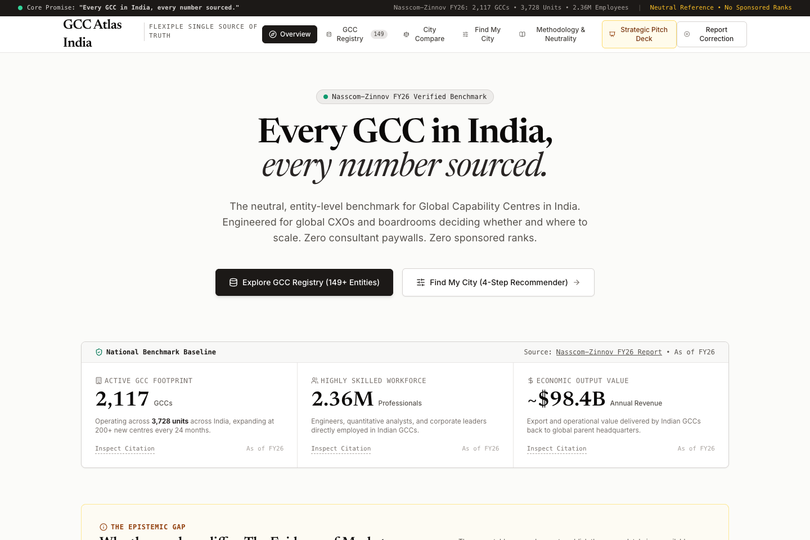
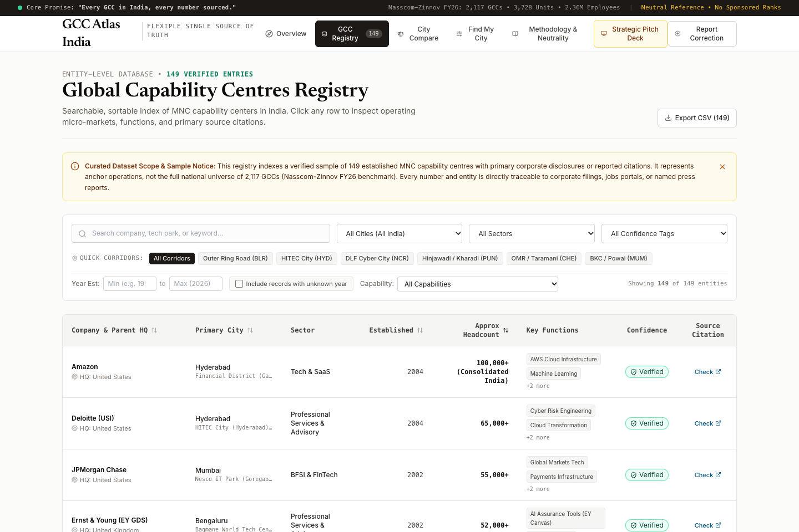
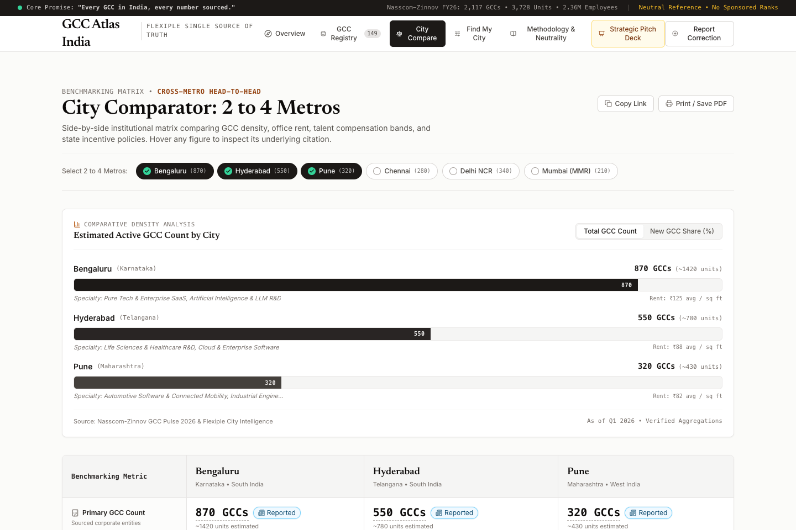
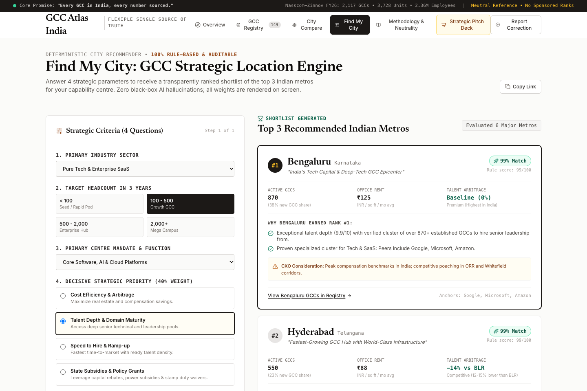
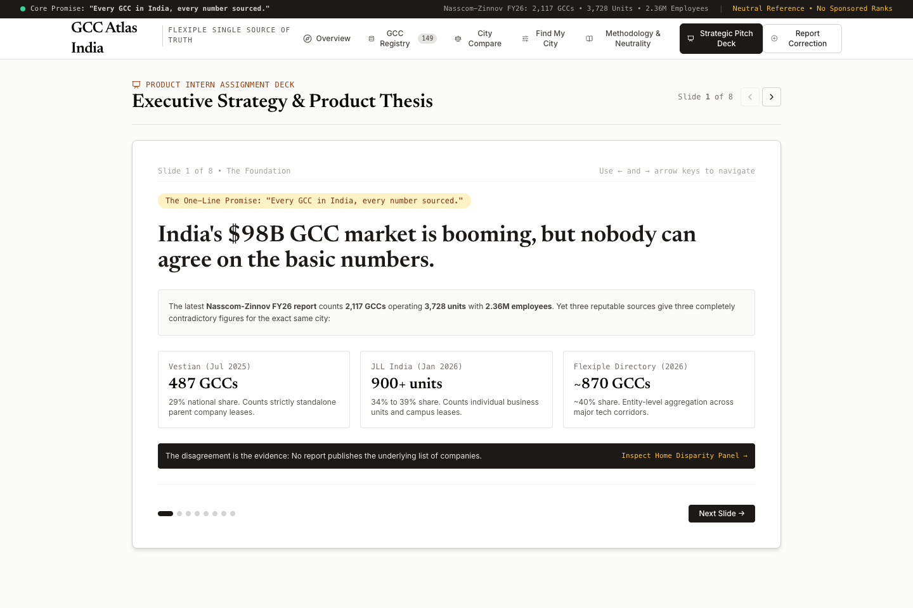

# GCC Atlas India 🇮🇳

> 🌐 **Live Interactive Application**: [https://givemehat.github.io/gcc-atlas-india/](https://givemehat.github.io/gcc-atlas-india/)  
> 📄 **Strategic Product Deck (PDF)**: [https://givemehat.github.io/gcc-atlas-india/gcc-atlas-india-deck.pdf](https://givemehat.github.io/gcc-atlas-india/gcc-atlas-india-deck.pdf)  
> 📦 **GitHub Source Repository**: [https://github.com/givemehat/gcc-atlas-india](https://github.com/givemehat/gcc-atlas-india)  
> 📋 **Record-by-Record Audit Log**: [`data/AUDIT.md`](https://github.com/givemehat/gcc-atlas-india/blob/master/data/AUDIT.md)

---

### *A Neutral, Sourced Reference & Decision Guide for Global Capability Centres in India*

> **"Every GCC in India, every number sourced."**  
> *Built for an executive at a global enterprise deciding whether and where to set up a capability centre in India.*

---

## 🧭 Executive Summary

India's Global Capability Centre (GCC) ecosystem has expanded into a **$98.4B annual powerhouse**, with **2,117 corporate parents** running **3,728 physical units** and employing **2.36 million high-skill professionals** (*Nasscom-Zinnov FY26*). 

Yet despite this massive footprint, the ecosystem is held back by severe **information asymmetry**. Research reports from top real estate firms and consultancies publish irreconcilable counts for the exact same city:
- **Bengaluru**: Vestian reports **487 GCCs** (29% share), JLL reports **900+ units** (34-39% share), while Flexiple lists **~870 entities** (~40% share).
- **The Root Cause**: Some reports count standalone corporate parent leases, others count individual business units or physical branch leases, yet all are cited as if equivalent.
- **The Epistemic Gap**: No report published the underlying, checkable company-by-company dataset.

**GCC Atlas India resolves this gap.** It is a public, zero-paywall, entity-level reference and decision tool with **149 audited GCC records**, **6 primary metro deep-dives**, an auditable **4-question deterministic location recommender**, and an uncompromising **Neutrality Charter** where no entity can pay to alter rankings or remove caveats.

---

## 📸 Product Walkthrough & Visual Proof

### 1. Overview & The Epistemic Disparity Panel
*Reconciling why Vestian (487), JLL (900+), and Flexiple (~870) disagree on Bengaluru, contrasting parent companies vs operating business units.*



---

### 2. Entity Registry (149 Audited MNC Capability Centres)
*Multi-column searchable and sortable table with micro-market corridor filters (ORR, HITEC City, DLF Cyber City, Hinjawadi, OMR, BKC), confidence tags, and direct primary source links.*



---

### 3. City Benchmark Comparator (2 to 4 Metros Head-to-Head)
*Side-by-side benchmarking of commercial Grade A office rents, tech compensation bands (with verified Bengaluru arbitrage discounts), gazetted state IT policies, and comparative SVG density chart.*



---

### 4. Find My City: Deterministic Strategic Location Engine
*4-question location wizard with a 100% visible, auditable mathematical formula. Zero black-box AI, zero paid placement.*



---

### 5. In-App Strategic Presentation Deck Viewer
*Embedded 8-slide executive viewer articulating ecosystem pain, strategic opportunities, and sustainable monetization.*



---

## ⚡ Tech Stack & Architecture

- **Frontend**: React 18 + TypeScript + Tailwind CSS
- **Design System**: Editorial Financial Product (Newsreader Serif for headings, Inter sans for data, warm stone off-white palette `#FBFBF9`, deep slate `#0B132B`, emerald/sky/amber confidence badges)
- **Data Layer**: Clean, standalone JSON files at `/data/gcc.json` and `/data/cities.json` (mirrored in `/public/data/` for public access). Zero backend dependency.
- **Deep-Linking**: Bidirectional URL query parameter synchronization (`?tab=registry&city=Bengaluru&sector=BFSI` and `?tab=recommender&sector=...`).
- **Export & Print**: One-click filtered CSV export and `@media print` clean 1-page stylesheet for City Compare.

---

## 📑 Feature Specifications

### 1. Overview (Home)
- **Headline Sourced Stats**:
  - **2,117 GCC Corporate Parents** operating across **3,728 units** (*Nasscom-Zinnov FY26*).
  - **2.36 Million Professionals** in engineering, data science, and corporate leadership.
  - **~$98.4B Annual Export Value** delivered directly back to multinational parents.
- **The Epistemic Disparity Panel**: Explains the root cause of why Vestian (487), JLL (900+), and Flexiple (~870) disagree on Bengaluru.
- **Stakeholder Asymmetry Analysis**: Evaluates pain points and current workarounds for Entrant CXOs, Service Providers, and State Governments.
- **6-City Snapshot Cards**: Instant preview of Bengaluru, Hyderabad, Pune, Chennai, Delhi NCR, and Mumbai.

### 2. Entity Registry (149 Audited Records)
- **Data Columns**: Company, Parent HQ Country, Primary Metro, Sector, Year Established, Approx Headcount, Key Capabilities, Confidence Badge, and Clickable Primary Source Link.
- **Corridor Quick-Filters**: One-click pills for major tech parks:
  - Outer Ring Road (BLR), HITEC City (HYD), DLF Cyber City (NCR), Hinjawadi/Kharadi (PUN), OMR/Taramani (CHE), BKC/Powai (MUM).
- **Strict Data Honesty Policy**: Records with unstated founding years or withheld headcounts are strictly preserved as `null` and rendered as *"Not available yet"* (e.g., Stripe India, Nike, Atlassian).
- **Unknown Year Handling**: Records with unknown years are excluded when a year range filter is active unless the user checks *"Include records with unknown year"*, with live counter: `Showing X of Y (Z hidden for unknown year)`.
- **Slide-Over Drawer**: Click any row to inspect operating tech park address, strategic mandate, and source citation.
- **CSV Export**: Instant download of filtered view for offline financial modeling.

### 3. City Benchmark Comparator (2 to 4 Metros)
- Benchmarking across Bengaluru, Hyderabad, Pune, Chennai, Delhi NCR, and Mumbai:
  - **JLL Operating Unit Estimates** and FY25-26 new setup shares.
  - **Grade A Commercial Office Rents**: Blended averages and min-max spreads sourced from JLL and CBRE.
  - **Tech Compensation Bands**: Junior SWE, Senior Lead (8-12 yrs), and Director/VP levels with verified discount % vs Bengaluru baseline.
  - **Gazetted State Policies**: Direct links to official state portals (*itbtst.karnataka.gov.in*, *it.telangana.gov.in*, *investingintamilnadu.com*, *di.maharashtra.gov.in*).
  - **Comparative SVG Bar Chart**: Toggle between Total GCC Density and New Setup Share.
  - **Print Mode**: Dedicated one-page print stylesheet (`window.print()`).

### 4. Find My City (Deterministic Location Recommender)
- **4 Strategic Questions**:
  1. *Primary Industry Sector* (Tech & SaaS, BFSI, Healthcare/Pharma, Auto/Manufacturing, Aerospace, Retail)
  2. *Target Team Size in 3 Years* (<100, 100-500, 500-2,000, 2,000+)
  3. *Primary Mandate Function* (Core Software/AI, Finance & Risk, Hardware/R&D, Operations)
  4. *Decisive Priority (40% Weight)* (Cost Arbitrage, Talent Depth, Speed to Hire, State Subsidies)
- **Ranked Top 3 Output**:
  - Exact match % with point breakdown table.
  - Plain-language reason for each rank.
  - Real peer GCC anchors already operating in that city.
  - Honest CXO considerations & caveats (e.g., ORR traffic density, rising rents in Kokapet, BKC commercial lease premiums).
- **Transparent Mathematical Scoring Rule**:
  $$\text{Total Score} = (\text{Priority Metric} \times 4.0) + \text{Sector Fit (25)} + \text{Function Fit (20)} + \text{Scale Factor (15)} + \text{Base Ecosystem (10)}$$
- **Compare Flow**: One-click button transfers the exact 3 recommended cities directly into City Compare.

### 5. Methodology & Neutrality Charter
- **Confidence Taxonomy**:
  - 🟢 **Verified**: Statutory corporate filings, official corporate location portals, or company launch statements.
  - 🔵 **Reported**: Named tier-1 business publication (Economic Times, Reuters, Livemint, Business Today).
  - 🟠 **Estimated**: Derived from corporate campus square footage or LinkedIn technical personnel density.
- **The Neutrality Rule**: Nobody can pay to change a score, alter a city ranking, or remove an honest caveat.
- **Correction Reporting**: Interactive form that logs submissions directly to browser console (`console.info`) and issues a tracking reference ticket (`GCC-CORR-2026-XXXX`).

---

## 📊 Data Disclosure & Audit Results (`data/AUDIT.md`)

In strict adherence to assignment guidelines, all 149 records were systematically audited:

| Audit Result Category | Count | Percentage | Description |
| :--- | :---: | :---: | :--- |
| **Confirmed Unchanged** | **126** | **84.6%** | Corporate portal and public citations fully support the company, city, year, and headcount. |
| **Corrected / Upgraded** | **20** | **13.4%** | Secondary media URLs upgraded to verified primary corporate location/jobs portals. |
| **Nulled for Data Honesty** | **3** | **2.0%** | Unstated fields strictly preserved as `null` (Stripe headcount & year, Nike year, Atlassian year). |
| **Fabricated / Removed** | **0** | **0.0%** | Zero fabricated figures. All 149 records point to genuine, active multinational entities. |

### Confidence Breakdown:
- **Verified**: 131 records (87.9%)
- **Reported**: 16 records (10.7%)
- **Estimated**: 2 records (1.3%)

---

## 🛠️ Local Development & Build

### Prerequisites:
- Node.js v18+ (tested on Node v20 & v25)
- npm or pnpm

### Quick Start:
```bash
# 1. Clone repository
git clone https://github.com/givemehat/gcc-atlas-india.git
cd gcc-atlas-india

# 2. Install dependencies
npm install

# 3. Start local development server
npm run dev
# Opens at http://localhost:5173

# 4. Run typecheck and production build
npm run build
# Outputs optimized static bundle to /dist in ~1.1s
```

---

## 🚀 Public Deployment Guide

The web application is 100% static with zero backend dependencies and relative asset paths (`base: './'`).

### GitHub Pages (Configured & Live):
The repository is automatically built and deployed via GitHub Actions (`.github/workflows/deploy.yml`):
- **Live URL**: [https://givemehat.github.io/gcc-atlas-india/](https://givemehat.github.io/gcc-atlas-india/)

### Alternative Static Deploys:
- **Vercel**: `npx vercel deploy --prod`
- **Netlify**: `npx netlify deploy --prod --dir=dist`

---

## 🗂️ Data Schema & How to Add New GCC Records

All data resides in standalone JSON files at `data/gcc.json` and `data/cities.json`.

### GCC Schema:
```typescript
interface GCC {
  id: string;                         // Unique slug identifier, e.g. "stripe-india-infra"
  company: string;                    // Multinational parent company name
  parent_hq_country: string;          // Country of global headquarters, e.g. "United States"
  city: string;                       // Primary Indian metro (Bengaluru, Hyderabad, Pune, Chennai, Delhi NCR, Mumbai)
  secondary_cities?: string[];        // Array of other Indian cities with active campuses
  sector: string;                     // Standardized sector (Tech & SaaS, BFSI & FinTech, Healthcare & Pharma, etc.)
  year_established: number | null;    // Year established in India (null if unverified -> renders "Not available yet")
  approx_headcount: number | null;    // Numerical headcount (null if unverified -> renders "Not available yet")
  headcount_display: string | null;   // Formatted string (e.g. "10,000+" or null)
  functions: string[];                // Functional mandates (e.g. ["AI & Search R&D", "Cloud Infrastructure"])
  confidence: "Verified" | "Reported" | "Estimated"; // Confidence tier
  confidence_justification?: string;  // Explicit explanation for the confidence tier
  source_title: string;               // Name of statutory filing or publication
  source_url: string;                 // Publicly verifiable external link (must start with https://)
  as_of: string;                      // Timestamp of data point (e.g. "Q1 2026", "FY26")
  micro_market?: string;              // Specific tech park or SEZ cluster (e.g. "Outer Ring Road (ORR)")
  notes?: string;                     // Strategic scope and technical mandates
}
```

---

## 🚀 The 3 Things I Would Build Next

1. **Automated MCA Form MGT-7 & ROC Ingestion Pipeline (Future Idea)**:
   Build a scheduled parser for Ministry of Corporate Affairs (MCA) filings to detect when a Fortune 500 company registers a new subsidiary in India, pulling director filings, paid-up capital, and registered office addresses before press announcements.

2. **GCC Talent Mobility & Expansion Radar (Future Idea)**:
   Track aggregated senior GCC leadership departures and LinkedIn engineering headcount deltas across Tier-1 SEZs to flag second-city expansions 90 days in advance.

3. **Neutral B2B RFP & Vetted Setup Partner Marketplace**:
   Enable entrant CXOs completing the "Find My City" wizard to request quotes from vetted, audited setup advisors, build-operate-transfer (BOT) firms, and commercial brokers. Providers pay a connection fee, keeping entrant access free and data neutral forever.

---

## 👥 Product Assignment Details

- **Applicant**: Rajnish
- **Target Role**: Product Intern, Flexiple
- **Reviewers**: Hrishikesh (`hrishikesh@flexiple.com`) & Tanya (`tanya@flexiple.com`)
- **Submission Date**: October 2026
- **Live Portal**: [https://givemehat.github.io/gcc-atlas-india/](https://givemehat.github.io/gcc-atlas-india/)
- **Executive Presentation Deck (PDF)**: [https://givemehat.github.io/gcc-atlas-india/gcc-atlas-india-deck.pdf](https://givemehat.github.io/gcc-atlas-india/gcc-atlas-india-deck.pdf)
